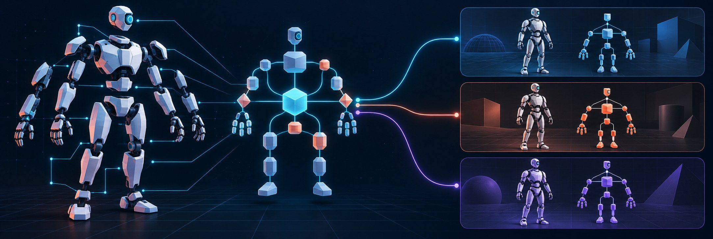
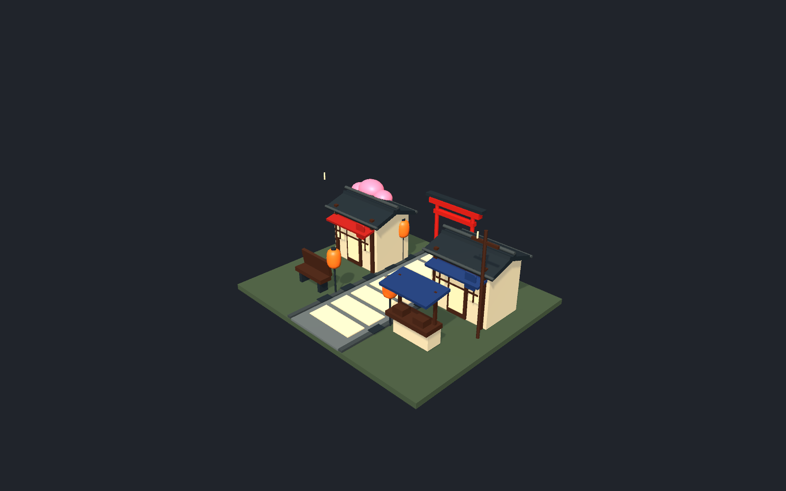
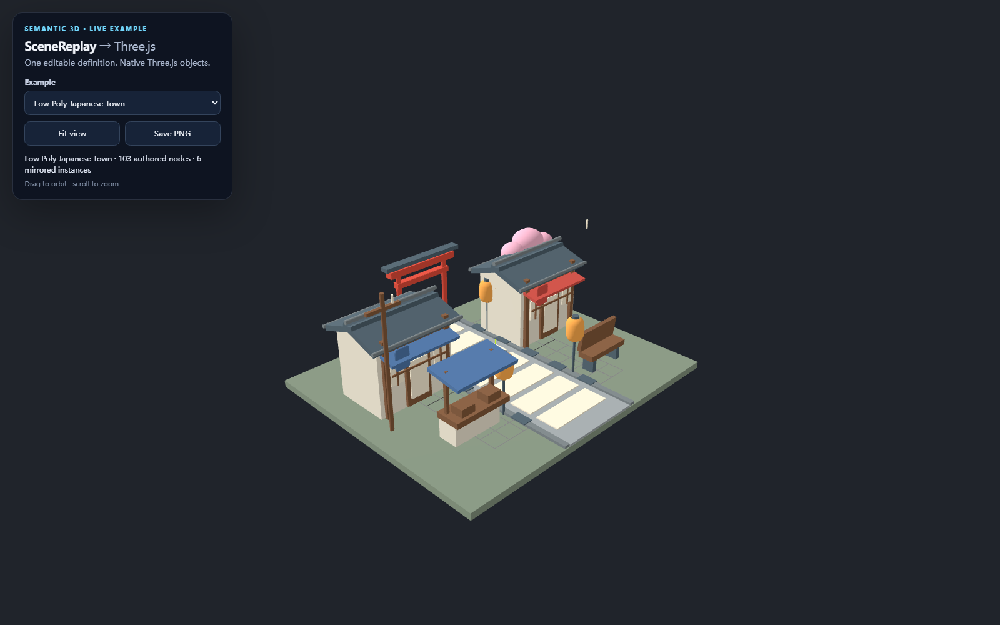
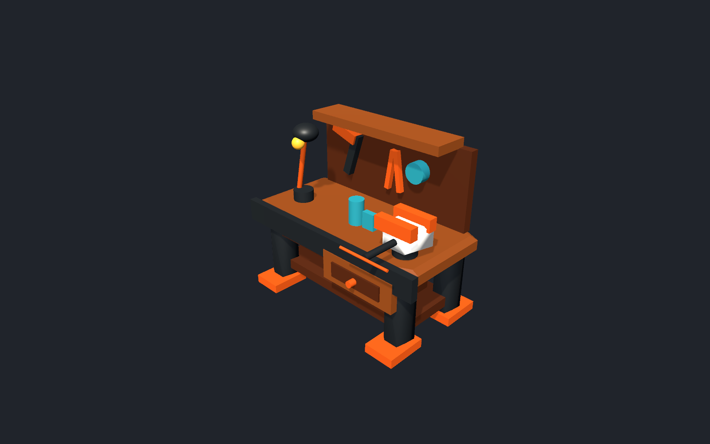
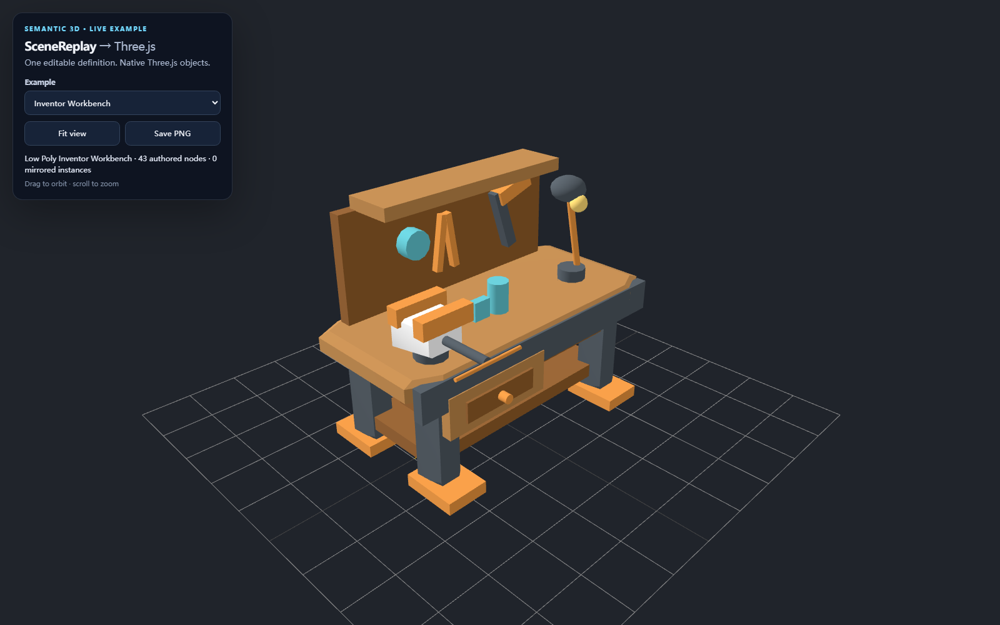

[English](README.md) · [简体中文](README.zh-CN.md)

# SceneReplay

**The semantic middle layer for editable 3D assets across game engines.**

<p align="center">
  
</p>

[](https://github.com/TristinOrg/SceneReplay/actions/workflows/repository-validation.yml)
[](https://unity.com/releases/editor/whats-new/2022.3.62)
[](https://godotengine.org/download/)
[](https://github.com/TristinOrg/SceneReplay/releases/tag/v0.1.0)
[](LICENSE.md)

SceneReplay gives AI and authoring tools a shared, engine-neutral way to describe and edit 3D assets. A definition keeps an asset as named parts with stable IDs, transforms, geometry parameters, rig roles, and gameplay metadata. Validate it, patch a single part, then adapt the same meaning into the native hierarchy of a target engine.

```text
AI / authoring tool → SceneReplay definition → validate / patch → engine adapter → editable scene
```

SceneReplay complements engines such as Unity, Unreal, Godot, and Three.js. The engine remains responsible for rendering and runtime behavior; SceneReplay carries portable asset structure and identity between tools. It is not an image-to-3D system or a replacement for Blender, Maya, or engine editors.

## Why SceneReplay

- **Keep assets understandable.** Stable IDs connect semantic parts across edits, regeneration, validation, and engine import.
- **Change only what changed.** Atomic patches address parts by ID, so tools can revise one component without resending an opaque whole model.
- **Preserve intent across engines.** Rig roles, anchors, collider rules, LOD declarations, palette roles, and gameplay tags live beside the geometry definition.
- **Keep AI optional.** SceneReplay validates and adapts documents without depending on a model provider.

## Engine support

| Target | Status | Current support |
|---|---|---|
| Unity | Available | Full package stack, eleven Low Poly geometry types, semantic rigs, reversible patches, native colliders, LOD groups, and GLB export |
| Three.js | Available | JavaScript adapter, eleven geometry types, mirror instances, semantic rig targets, game metadata, atomic semantic patches, and runnable browser example |
| Godot 4 | Available | GDScript adapter, eleven geometry types, semantic rig targets, atomic patches, optional native colliders, and runnable project |
| Unreal Engine | Planned | No adapter yet; implementation awaits a consuming project for native validation |

Adapters expose their supported features explicitly. See the [capability matrix and adapter details](Docs/Technical-Reference.md#semantic-interoperability-boundary).

## Try the examples

### Three.js

Requires Node.js 20.19+ or 22.12+. From the repository root:

```sh
cd Samples/three-consumer
npm ci
npm test
npm run dev
```

The browser sample includes the Unity-authored Japanese Town and Inventor Workbench, along with character, weapon, building, profile geometry, and semantic rig scenes. The town and workbench reuse the exact definitions and palettes from the Unity preset factories, making them a direct cross-engine comparison. Use **Fit view** and **Save PNG** to frame and export a scene.

| Shared preset | Unity | Three.js |
|---|---|---|
| Japanese Town |  |  |
| Inventor Workbench |  |  |

### Godot

Requires Godot 4.x. Open `Samples/godot-consumer/project.godot`, or run the headless adapter checks:

```sh
godot --headless --path Samples/godot-consumer --script res://tests/run_tests.gd
```

The sample lets you switch between the character, profile gallery, patch demo, and shared rig fixture.

### Unity

The Unity packages support Unity 2022.3 LTS. Add the packages from this repository to a Unity project; see [installation and package details](Docs/Technical-Reference.md#installation). The repository includes presets, Editor workflows, and a Python CLI that routes document operations through the Unity Editor.

## A small Unity quick start

```csharp
using SceneReplay.LowPoly;
using SceneReplay;
using UnityEngine;

ShapeDefinition definition = LowPolyRobotPreset.CreateDefinition();
ShapeStyleDefinition style = LowPolyRobotPreset.CreateStyle();
var generator = new LowPolyModelGenerator(new[] { style });
GameObject robot = generator.Generate(definition);
```

Generated nodes retain stable semantic IDs. Resolve a target once and edit its transform without relying on generated object names:

```csharp
using SceneReplay.Unity;

UnityShapeModel model = robot.GetComponent<UnityShapeModel>();
if (model.TryGetTarget("robot.head.pivot", out IShapeTransformTarget head))
    head.LocalEulerAngles = new Vector3(0f, 25f, 0f);
```

## The authoring loop

SceneReplay documents are ordinary versioned JSON. Schema and Core validate structure, capabilities, IDs, references, and safety limits before an adapter allocates native objects. A tool can request diagnostics, author a small patch, and validate the result again:

```text
Definition → validation / quality report → ID-addressed patch → adapter
     ↑                                                │
     └────────────── diff, review, or undo ────────────┘
```

The C# implementation is authoritative for validation, diff, patch, quality gates, construction plans, and GLB export. `tools/scenereplay.py` provides repeatable workflows through the Unity Editor bridge:

```sh
python tools/scenereplay.py validate model.json
python tools/scenereplay.py diff before.json after.json
python tools/scenereplay.py patch model.json change.json -o updated.json
python tools/scenereplay.py quality model.json policy.json
python tools/scenereplay.py export-glb model.json --asset Library/SceneReplay/model.glb -o report.json
```

See the [full CLI command list](Docs/Technical-Reference.md#automation-cli) and [published JSON Schemas](Packages/com.scenereplay.schema/Documentation~/Schemas).

## Geometry and extensibility

The official Low Poly backend currently supports cubes, spheres, cylinders, capsules, wedges, frustums, extruded profiles, profile lofts, profile cages, lathes, and profile sweeps. Geometry is an implementation behind the semantic format: teams can add realistic, voxel, SDF, custom-mesh, or engine-specific backends without making those styles part of Core.

Adapters and backends are separate extension points. Schema and Core do not depend on Unity, a renderer, an art style, or an AI provider. For implementation details, performance notes, safety limits, presets, and extension guidance, read the [technical reference](Docs/Technical-Reference.md).

## Documentation

| Need | Resource |
|---|---|
| Detailed API, contracts, performance, and workflow guide | [Technical Reference](Docs/Technical-Reference.md) |
| Development direction and planned work | [Roadmap](ROADMAP.md) |
| Shape and Style contract | [Schema specification](Packages/com.scenereplay.schema/Documentation~/SceneReplay-Specification.md) |
| Runnable engine consumers | [Three.js](Samples/three-consumer) · [Godot](Samples/godot-consumer) |
| Shared adapter fixture | [Rig conformance JSON](Samples/conformance/rigged-character.json) |
| Changes | [Changelog](CHANGELOG.md) |
| Contributing | [Contribution guide](CONTRIBUTING.md) |
| Security | [Security policy](SECURITY.md) |

## Validation

GitHub Actions checks package contracts, Three.js adapter tests and production build, and Godot project import and headless tests. Unity EditMode tests require Unity 2022.3; the Python CLI's document commands require a connected Unity Editor.

## License

SceneReplay is dual-licensed: **AGPL-3.0-or-later** for open-source use, or a **commercial license** for proprietary products that need different terms. See [LICENSE.md](LICENSE.md) and [commercial licensing](COMMERCIAL-LICENSE.md). Models generated by the unmodified project are not covered solely because SceneReplay produced them.

---

Created by Tristin Wen. The project aims to make semantically editable 3D assets a practical interchange layer for AI-assisted modeling and multi-engine workflows.
